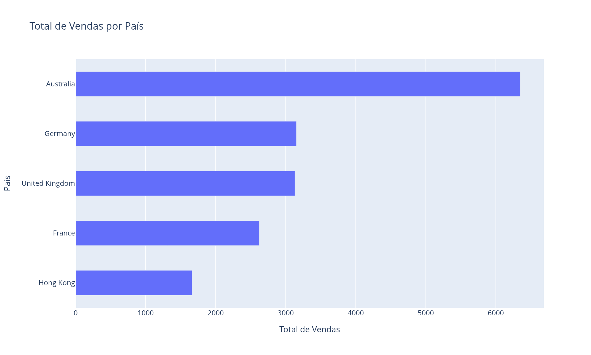

# Guia Plotly e Dash


## Sobre o Projeto

Guia prático de visualização de dados com **Plotly** e criação de dashboards web com **Dash**.

O guia tem duas partes:

- **Aulas** (`aulas/`): exercícios curtos e comentados, um conceito por arquivo, do primeiro app Dash aos componentes HTML;
- **Projeto de exemplo** (`src/dashvendas/`): um dashboard completo de vendas por país, que aplica as aulas do jeito que se faz em produção. Os dados de um e-commerce são lidos e agregados com **Pandas**, transformados em um gráfico de barras com **Plotly** e exibidos em uma página web criada com **Dash**.

O guia foi desenvolvido com finalidade educacional e de portfólio. O código é didático: cada passo vem comentado, para que quem está começando consiga acompanhar.

## Objetivos

- Ler e validar um CSV de vendas com Pandas;
- Agregar o valor dos pedidos por país;
- Gerar um gráfico de barras horizontais com Plotly Express;
- Exportar o gráfico como imagem (PNG);
- Publicar o gráfico em um dashboard web com Dash;
- Praticar componentes HTML do Dash.

## Dados

O projeto usa o dataset `data/raw/ecom_sales.csv`, com **500 registros** e seis colunas:

- **InvoiceNo**: número da nota do pedido;
- **Description**: descrição do produto;
- **OrderValue**: valor do item no pedido;
- **Quantity**: quantidade;
- **CustomerID**: código do cliente (101 registros sem cliente identificado);
- **Country**: país (Australia, France, Germany, Hong Kong e United Kingdom).

## Análise

Foram analisados indicadores relacionados a:

- Valor total vendido;
- Valor vendido por país;
- Pedidos, clientes e itens por país.

A soma de todos os pedidos é **16.918,64**.

A **Australia** lidera com **6.349,89**, quase o dobro do segundo lugar (**Germany**, com **3.153,71**).

**Hong Kong** tem o menor total, com **1.660,24**.

## Demonstração

### Total de Vendas por País



*Gráfico de barras horizontais gerado com Plotly: o país que mais vende aparece no topo.*

## Metodologia

O projeto foi desenvolvido em quatro etapas:

1. **Dados**: leitura e validação do CSV bruto com Pandas (`src/dashvendas/data.py`);
2. **Exploração**: qualidade dos dados e respostas às perguntas da análise (`notebooks/01_exploracao_dados.ipynb`);
3. **Visualização**: gráfico de barras com Plotly e exportação em PNG com Kaleido (`notebooks/02_visualizacao.ipynb`);
4. **Dashboard**: página web com Dash publicada em um servidor local (`src/dashvendas/dashboard.py`).

## Como Executar

1. Crie o ambiente virtual e instale as dependências (Python 3.14):

   ```bash
   python -m venv .venv
   source .venv/bin/activate
   pip install -r requirements.txt
   ```

2. Copie as configurações de exemplo:

   ```bash
   cp .env.example .env
   ```

3. Rode o pipeline completo (gera `data/processed/` e o gráfico em `reports/figures/`):

   ```bash
   python -m dashvendas.pipeline
   ```

4. Suba o dashboard e abra [http://127.0.0.1:8050](http://127.0.0.1:8050):

   ```bash
   python -m dashvendas.dashboard
   ```

5. (Opcional) Rode as aulas, explore os notebooks e rode os testes:

   ```bash
   python aulas/01_Dash.py
   jupyter lab notebooks/
   pytest
   ```

Para desligar o servidor, use `Ctrl+C` no terminal (ou o botão Stop do PyCharm).

## Tecnologias e Ferramentas

- **Python**
- **Pandas**
- **Plotly**
- **Dash**
- **Kaleido**
- **Jupyter**
- **pytest**
- **PyCharm**

## Estrutura do Projeto

```text
Guia_Plotly_Dash/
│
├── aulas/                     # aulas do guia, um conceito por arquivo
│   ├── 01_Dash.py
│   └── 02_DashHtml.py
│
├── data/
│   ├── raw/                   # dados originais (nunca editados à mão)
│   │   └── ecom_sales.csv
│   └── processed/             # dados tratados, gerados pelo pipeline
│
├── notebooks/                 # análise passo a passo
│   ├── 01_exploracao_dados.ipynb
│   └── 02_visualizacao.ipynb
│
├── reports/
│   └── figures/
│       └── vendas_por_pais.png  # gráfico exportado
│
├── src/
│   └── dashvendas/            # projeto de exemplo (pacote Python)
│       ├── config.py          # caminhos e variáveis do .env
│       ├── data.py            # leitura, validação e resumos
│       ├── visualization.py   # gráficos com Plotly
│       ├── pipeline.py        # roda tudo de ponta a ponta
│       └── dashboard.py       # app web com Dash
│
├── tests/                     # testes automatizados (pytest)
├── .env.example               # modelo das configurações
├── pyproject.toml             # metadados do pacote
├── requirements.txt           # dependências
└── README.md
```

## Objetivo de Aprendizagem

Este projeto foi desenvolvido para praticar e consolidar conhecimentos em:

- Leitura, validação e agregação de dados com Pandas;
- Visualização de dados com Plotly;
- Desenvolvimento de dashboards web com Dash;
- Exportação de gráficos como imagem;
- Organização de projetos de dados (notebooks + pacote Python);
- Testes automatizados com pytest;
- Organização e documentação de projetos.

## Autor

**Cristian Matias de Souza**, Analista de Dados
